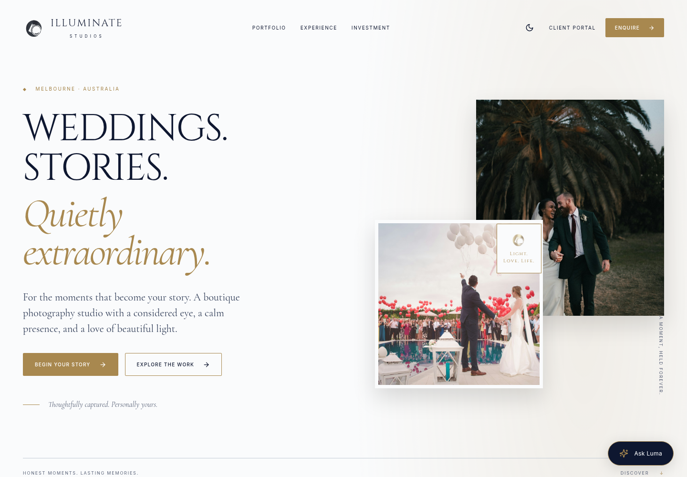

# Entry page completion report — 2026-10-02

Branch: `feature/illuminate-entry-page`. No production deployment performed.

Implemented the Illuminate Studios public entry page using the included design
source and current content policy. The UI includes local fonts/brand imagery,
a responsive hero and navigation, gallery reel/photo viewer, experience and
collection sections, consent-based enquiries, and Luma chat. Theme preference
persists across reloads; keyboard dialogs restore focus. All page navigation
and CTAs lead to implemented interactions or explicit portal entry information.

The FastAPI backend now persists tentative enquiries in MongoDB with UUID
idempotency keys and reference numbers. Luma uses server-side OpenAI Chat
Completions, server-owned history/state, draft fields, response validation,
regeneration and safe fallbacks. It cannot reserve dates or confirm bookings.
Optional Resend studio alerts track delivery status and support retries.

## Verification

- Root `pnpm build`: shared token declarations/CSS and web production build passed.
- Root `pnpm lint:web`: passed.
- Backend `ruff check .`: passed.
- Backend `pytest -q`: **52 passed**. Includes persistence, consent, idempotency,
  invalid inputs, server-owned state, provider failure, policy regressions,
  rate limits, concurrent state changes, and email delivery success/failure.
- `python web/tests/entry_page.py`: passed against the isolated browser backend.
  Verified Luma → prefilled form → consent → receipt → pending-state follow-up;
  service-error input preservation without false receipts; photo arrow-key
  navigation/Escape/focus restoration; mobile menu, theme reload, portal and 404
  routes; no horizontal overflow at 320, 390, 768, 1024, and 1440px.
- No browser JavaScript errors. Local photos and self-hosted fonts rendered.
- `git diff --check`: passed.

[Mobile entry page screenshot](assets/entry-page-mobile.png)

## Runtime configuration and remaining milestones

No OpenAI API key or MongoDB URI was configured in this execution environment.
Provider verification used an HTTP mock, and the browser suite used in-memory
MongoDB and a deterministic Luma replacement. No live OpenAI request, email, or
production database write was made. Supply backend `OPENAI_API_KEY`, MongoDB
settings and production web/CORS origins to operate against live services.
Studio email alerts additionally require the optional Resend configuration.

The six portfolio photographs are explicitly labelled Unsplash samples and
must be replaced with approved studio work before public launch. Collection
pricing derives from the supplied prototype and is presented as indicative.
Private portal authentication, payment collection, live availability calendars,
and the R2 private media pipeline remain separate project milestones.

See [setup and operating notes](../docs/entry-page.md) for exact commands,
notification monitoring/retries, conversation retention and deployment limits.
No Railway or CI infrastructure files were changed.
